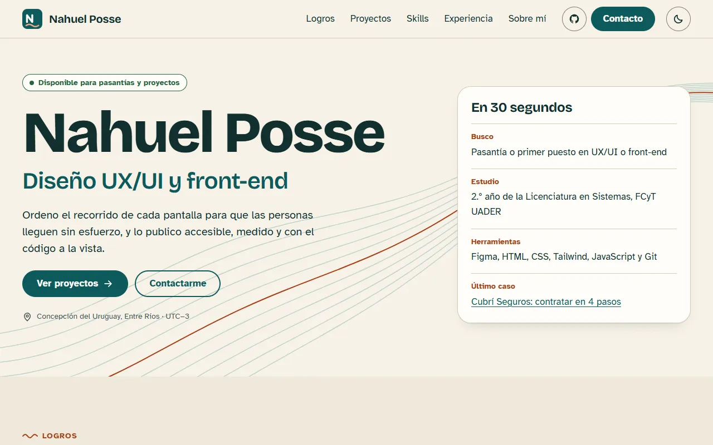
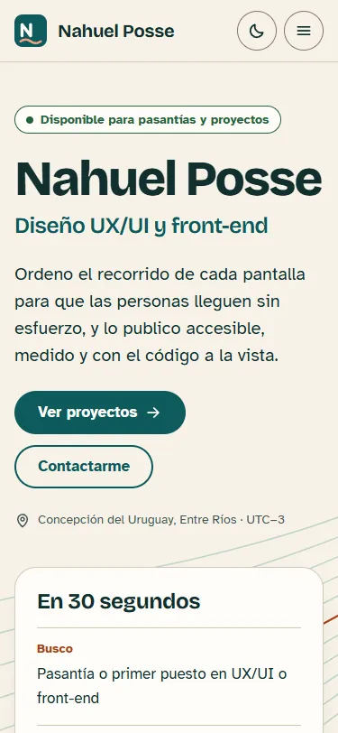
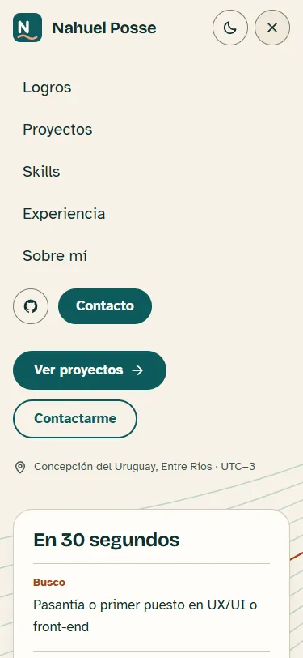
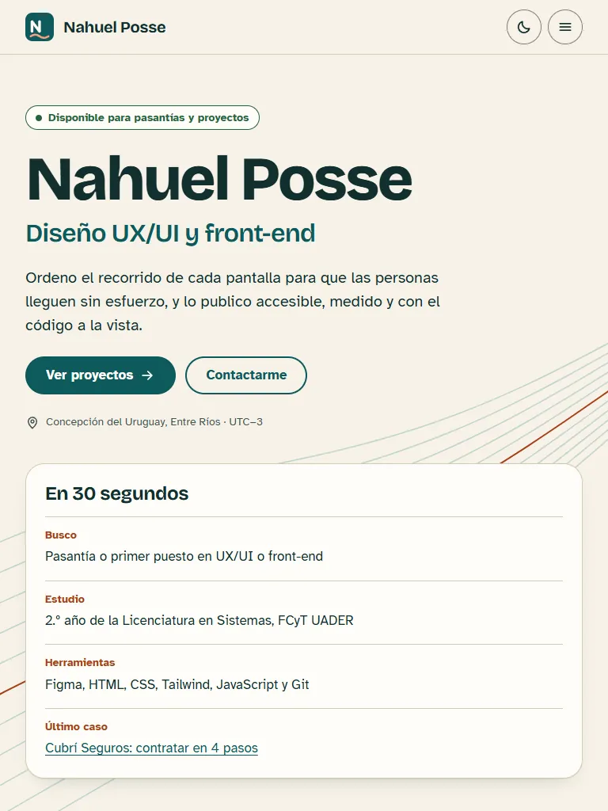
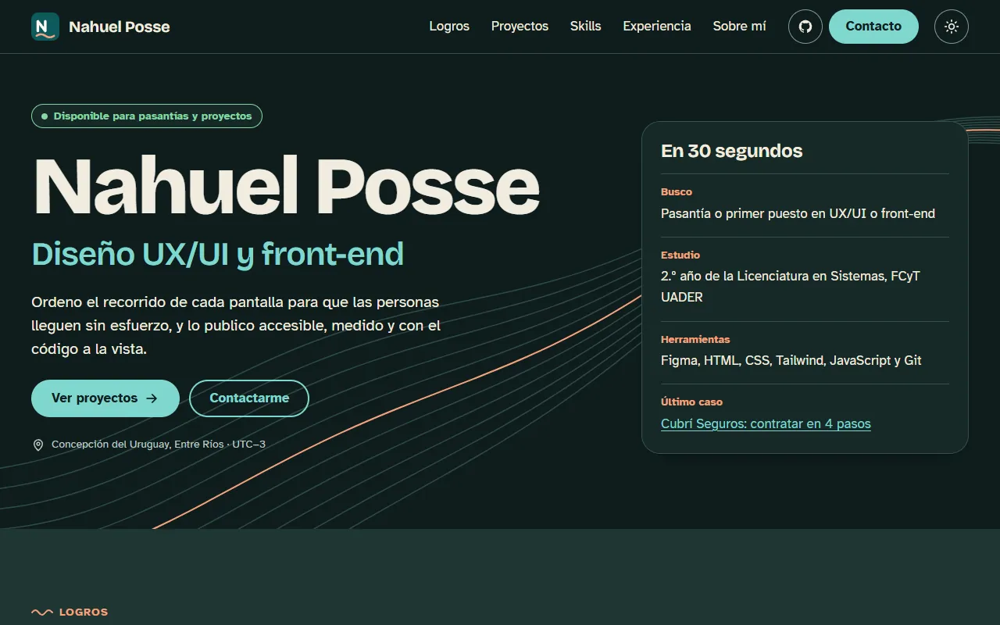

# Portfolio de Nahuel Posse

Trabajo final de **Diseño UX-UI 2026**. Licenciatura en Sistemas de Información, FCyT UADER, Sede Concepción del Uruguay.

| | |
|---|---|
| **Sitio publicado** | https://nahux-controlz.github.io/ |
| **Figma** | [Research, wireframes, design system y prototipo](https://www.figma.com/design/YqBoTCbp9uNfBJ8tmT5pbe) |
| **Proceso (PDF)** | [docs/proceso.pdf](docs/proceso.pdf) |
| **Test de usabilidad** | [docs/test-usabilidad.md](docs/test-usabilidad.md) |
| **Lighthouse (mobile)** | [Captura](docs/lighthouse-mobile.png) · [Reporte](docs/lighthouse-mobile.html) |



## Stack

HTML5, CSS3 y JavaScript vanilla, sin frameworks ni build. Se publica en GitHub Pages con GitHub Actions.

- **Tipografías:** Bricolage Grotesque y Atkinson Hyperlegible, autoalojadas con `font-display: swap`.
- **Imágenes:** WebP con `width`, `height` y `loading="lazy"` debajo del pliegue.
- **JavaScript:** solo mejora la experiencia (menú, tema, sección actual, copiar email). El contenido se lee sin él.

## Concepto: Cauce

Un cauce ordena el agua sin frenarla. Las tres palabras de la marca personal son **claro, metódico y cercano**. El detalle está en Figma y en el PDF de proceso.

## Estructura

```
├── index.html             página principal (9 secciones)
├── casos/                 casos de estudio: Cubrí Seguros y Viandas
├── 404.html               página no encontrada
├── css/tokens.css         variables del design system, iguales a las de Figma
├── css/main.css           estilos mobile-first
├── js/                    tema (theme.js) e interacciones (main.js)
├── assets/                fuentes e imágenes
├── docs/                  proceso, test de usabilidad, Lighthouse y capturas
└── .github/workflows/     deploy a GitHub Pages
```

**Cambio de orden:** Proyectos va antes que Skills. La persona que evalúa busca pruebas de trabajo antes que una lista de herramientas (ver Figma, página 01).

## Requisitos verificados

| Requisito | Resultado | Cómo se comprobó |
|---|---|---|
| Lighthouse mobile ≥ 90 | 100 en Performance, Accessibility, Best Practices y SEO | Lighthouse 13 sobre la URL pública |
| WCAG 2.2 AA | Sin violaciones | axe-core en 4 páginas, 3 anchos y 2 temas |
| Responsive sin scroll horizontal | 375, 768 y 1280 px | Script con Chrome headless y revisión de capturas |
| Teclado | Recorrido completo, foco visible y enlace para saltar al contenido | Recorrido con Tab por script |
| Menú mobile | `aria-expanded`, `aria-controls` y cierre con Escape | Script con Chrome headless |
| Movimiento reducido | Animaciones desactivadas con `prefers-reduced-motion` | Revisión del CSS |

| Mobile | Menú | Tablet | Modo oscuro |
|---|---|---|---|
|  |  |  |  |

## Validación

**Estado: pendiente.** El test con al menos 3 personas todavía no se hizo. La guía, las tareas y la planilla de resultados están en [docs/test-usabilidad.md](docs/test-usabilidad.md). Los hallazgos y los cambios aplicados se van a documentar ahí.

## Correr en local

No hace falta compilar. Hay que servirlo por HTTP para que funcionen las rutas absolutas de la página 404:

```bash
python -m http.server 8000
```

## Deploy

El sitio se publica solo en cada push a `main`, con [.github/workflows/deploy.yml](.github/workflows/deploy.yml).

1. Crear el repositorio público `nahux-controlz.github.io`, que publica en la raíz del dominio.
2. En **Settings → Pages → Build and deployment → Source**, elegir **GitHub Actions**.
3. Hacer push a `main`. El workflow copia los archivos del sitio a `_site` (sin `docs/`), los sube y los publica.
4. Ver el estado en la pestaña **Actions**. La URL final también está en la descripción del repositorio.

## Bonus

- Modo claro y oscuro, con `prefers-color-scheme` y toggle.
- Dos casos de estudio con navegación entre proyectos.
- Página 404 personalizada.
- Animaciones accesibles: líneas de río, tarjetas y línea de tiempo.
- Content Security Policy por `meta`. GitHub Pages no permite configurar headers propios.

## Créditos y recursos

- **Templates:** no se usó ninguno. El diseño y el código se hicieron desde cero.
- **Fuentes:** [Bricolage Grotesque](https://fonts.google.com/specimen/Bricolage+Grotesque) y [Atkinson Hyperlegible](https://fonts.google.com/specimen/Atkinson+Hyperlegible) (licencia OFL), vía Fontsource.
- **Íconos:** dibujados en SVG para este sitio. El logo de GitHub pertenece a GitHub.
- **Capturas de proyectos:** Cubrí Seguros y Coffea son trabajos propios de la cursada.
- **Herramientas de verificación:** Lighthouse y axe-core.

## Uso de IA

Se usó un asistente de IA.

**Qué se generó con IA:** el código del sitio, los textos a partir de los trabajos reales del alumno, el archivo de Figma (research, wireframes, design system y prototipo), el PDF de proceso, la guía del test, este README y las capturas compuestas.

**Qué no generó la IA:** el test con personas, que debe hacer el alumno, y los proyectos que se muestran, que se resolvieron en la cursada.

**Cómo se revisó:**

- Los datos se compararon con los repositorios y reportes del alumno: cantidades, tecnologías y resultados.
- Accesibilidad, responsive y performance se midieron con las herramientas de la tabla anterior.
- El alumno revisa textos y datos personales antes de la entrega.

**Orden real del trabajo:** el prototipo de alta fidelidad se generó a partir de la maqueta, no antes. Por eso coincide con el sitio. El test se hace sobre ese prototipo y sus cambios se aplican en Figma y en el código.
